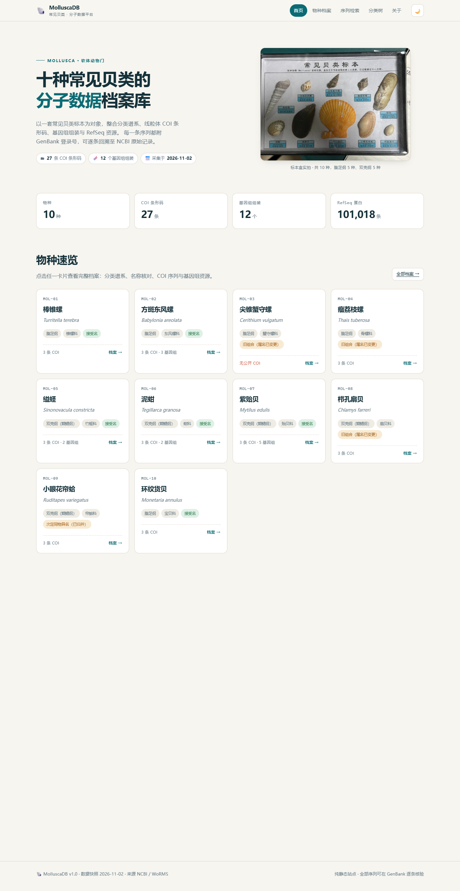
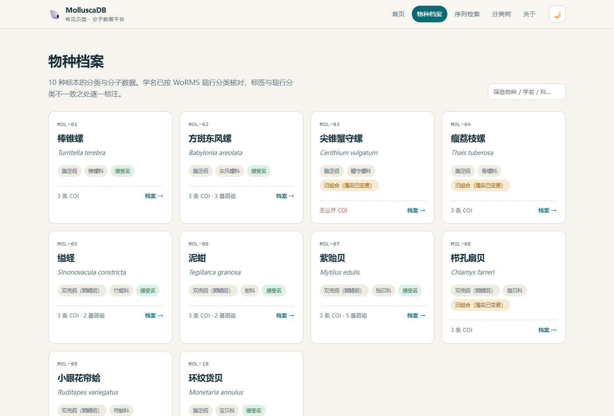
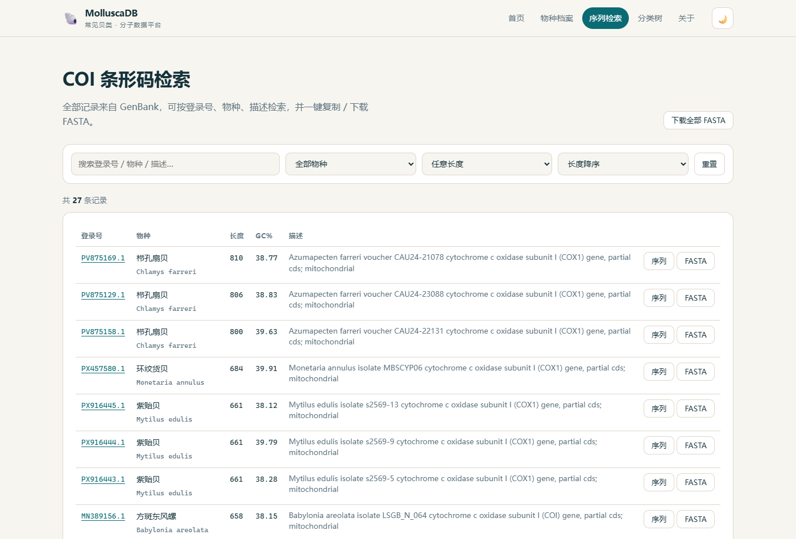
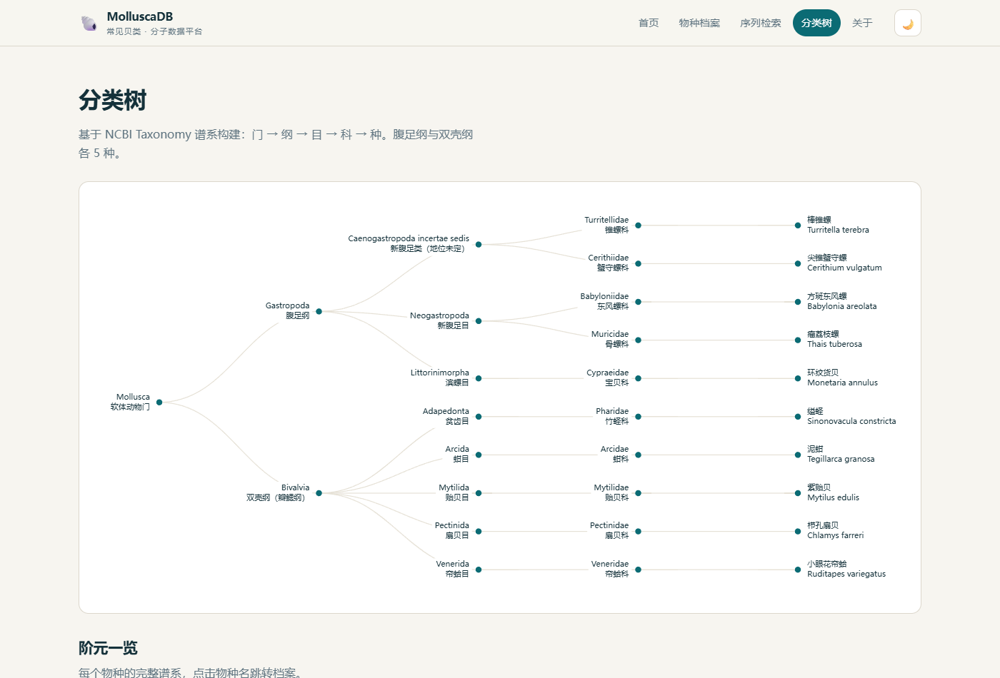

# 🐚 MolluscaDB · 常见贝类分子数据平台

一套常见贝类标本（10 种）的分类与分子数据档案库。**纯静态站点，无后端、无数据库、无密钥**，克隆即可运行，推送到 GitHub Pages 即可上线。

> 设计原则：**只放可核验的数据**。每条序列都有 GenBank 登录号，每个分类名都对过 WoRMS，缺数据就明说「无公开 COI」，不用近缘种序列顶替，也不放模拟表达谱。

---

## 快速开始

```bash
# 方式一：Python 内置服务器
python -m http.server 8000

# 方式二：Node
npx serve .

# 然后打开 http://localhost:8000
```

⚠️ 不要直接双击 `index.html`——浏览器同源策略会阻止 `fetch('data/species.json')`，页面会提示加载失败并给出上述命令。

## 部署到 GitHub Pages

```bash
git init
git add .
git commit -m "MolluscaDB v1.0"
git remote add origin https://github.com/<你的用户名>/<仓库名>.git
git push -u origin main
```

仓库 Settings → Pages → Source 选 `main` / `root`，等待 1 分钟即可。路径为 `https://<用户名>.github.io/<仓库名>/`。
（`.nojekyll` 已包含，避免 GitHub 的 Jekyll 处理干扰静态资源。）

---

## 目录结构

```
mollusca-db/
├── index.html              单页应用入口（5 个视图）
├── assets/
│   ├── style.css           全站样式（含深色模式）
│   ├── app.js              前端逻辑（原生 JS，无框架）
│   ├── echarts.min.js      Apache ECharts 5.4.3（本地打包，离线可用）
│   └── specimen.jpg        标本盒实拍图
├── data/
│   ├── species.json        ★ 数据层（10 物种 + 27 条 COI + 12 个基因组）
│   ├── raw.json            采集原始返回
│   ├── worms.json          WoRMS 名录核对结果
│   └── fasta/              按物种拆分的 FASTA 文件
└── tools/
    ├── collect.mjs         NCBI 采集：分类谱系 / COI / 基因组 / 记录数
    ├── worms.mjs           WoRMS 学名与科属核对
    ├── build.mjs           生成 data/species.json
    ├── serve.mjs           本地静态服务器
    └── verify-ui.mjs       无头浏览器自检（截图 + 控制台报错）
```

## 截图

| 首页 | 物种档案 |
|---|---|
|  |  |

| 序列检索 | 分类树 |
|---|---|
|  |  |

## 数据来源

| 来源 | 用途 |
|---|---|
| NCBI Nucleotide（E-utilities） | COI 条形码序列、GenBank 登录号 |
| NCBI Taxonomy | 分类谱系、TaxID |
| NCBI Datasets / Assembly | 基因组组装、大小、N50 |
| NCBI Protein | RefSeq 蛋白记录数 |
| WoRMS（世界海洋物种名录） | 学名接受状态、科属归属 |

**数据快照：2026-11-02。** 重新采集：

```bash
node tools/collect.mjs   # 约 1 分钟，NCBI 限速 3 次/秒
node tools/worms.mjs
node tools/build.mjs
```

## 站点内容

| 视图 | 内容 |
|---|---|
| 首页 | 标本实拍、四类统计、物种速览、各物种公开 COI 存量（对数对比） |
| 物种档案 | 形态、生境、名称核对（标签名 vs 现行接受名）、分类谱系、COI 序列、基因组、数据统计 |
| 序列检索 | 按登录号/物种/描述/长度筛选，查看序列、复制与下载 FASTA，长度-GC 散点图 |
| 分类树 | 门→纲→目→科→种 的可折叠树图 + 阶元一览表 |
| 关于 | 数据来源、核验方式、标签差异、技术说明、免责 |

## 标本标签 vs 现行分类

标签上的学名有 4 处已不是 WoRMS 现行接受名，站内保留标签原名并并列标注：

| 中文名 | 标签学名 | 现行接受名 | 说明 |
|---|---|---|---|
| 尖锥蟹守螺 | *Cerithium vulgatum* | *Thericium vulgatum* | 属名变更 |
| 瘤荔枝螺 | *Thais tuberosa* | *Menathais tuberosa* | 属名变更；科为骨螺科 Muricidae |
| 栉孔扇贝 | *Chlamys farreri* | *Scaeochlamys farreri* | 属名变更（NCBI 用 *Azumapecten*） |
| 小眼花帘蛤 | *Ruditapes variegatus* | *Ruditapes aspera* | 次定同物异名 |

另外两处值得注意：

- **缢蛏**：标签写「竹蛏科 Pharidae」是**对的**（WoRMS 同此），NCBI 将其置于 Solecurtidae，属数据库间差异，不是标签错误。
- **尖锥蟹守螺**：NCBI 无公开 COI 条形码，仅 3 条微卫星序列，站内明确标注「无公开 COI」。

## 已知取舍

- **没有表达谱模块**：没有实测转录组就不放表达量。若后续要做，建议接入真实 RNA-seq（SRA 下载 + 定量），而不是手工构造数值。
- 每物种收录 3 条代表性 COI（优先选长度接近标准条形码 658 bp 的）。全部公开记录数在物种档案「数据统计」中单独列出，二者不混淆。
- 中文形态/生境描述为面向教学的概括性文字，不替代分类学文献；引用请回到 WoRMS / 原始发表文献。

## 许可与免责

数据版权归 NCBI / WoRMS 及各原始发表者所有，本站仅作整理与可视化，供教学与科研参考。用于正式发表前请自行复核并引用原始文献。
